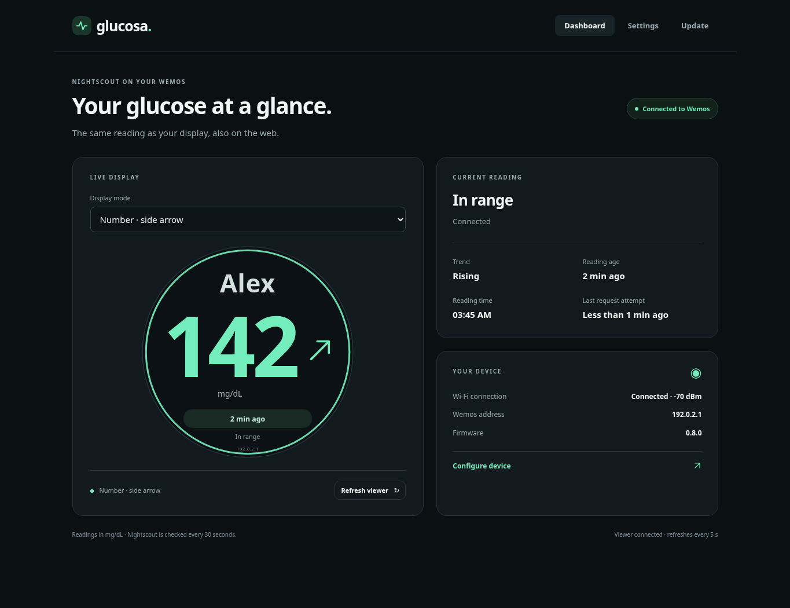
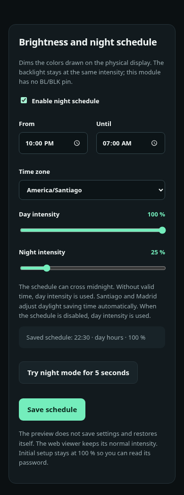

# Glucose at a glance

[Español](README.md) · **English**

A small desktop viewer that shows **Nightscout** glucose readings on a round
screen and in a phone or computer browser. It displays a large number, trend
arrow and reading age, using a dark, high-contrast interface.

The current hardware is a **Wemos D1 mini ESP8266 with 4 MB flash** and a
**GC9A01 SPI 240 × 240 display**. ESP32 support is planned; it is not available yet.

## Start here

| I want to… | Open |
| --- | --- |
| Build and set up the device | [Step-by-step installation guide](docs/INSTALLATION.en.md) |
| Check the seven connections | [Wiring table and diagram](docs/INSTALLATION.en.md#2-connect-the-display) |
| Download ready-to-install firmware | [Firmware downloads](firmware/README.en.md) |
| Get a server public key, if needed | [Windows, Linux and macOS key tools](tools/key-export/README.en.md) |
| See future plans, including ESP32 | [Roadmap](ROADMAP.en.md) |
| Build from source or understand security | [Technical reference](docs/TECHNICAL.en.md) |

## How it works

[Nightscout](https://nightscout.github.io/) makes glucose data available through
a web server. This viewer needs **an existing Nightscout installation with
readings**, either your own or one you are authorized to access, such as a family
member's server.

The data travels from **the sensor and its uploader → Nightscout → your home
Wi-Fi → Wemos and display**. Your browser connects to the Wemos to show a copy
of the display and change settings. The Wemos does not read the sensor directly
and does not install or host Nightscout.

You need the board, display, seven wires, USB power, a **2.4 GHz** Wi-Fi network
and your Nightscout address. A computer is needed for the first USB installation;
afterwards, settings and normal updates are available through the local web page.

## Current features

| Feature | Available now |
| --- | --- |
| Physical and web display | Glucose in **mg/dL**, trend arrow, reading age and connection status. |
| Three display modes | A **30-minute graph**, large number with a side arrow, or centered number with the arrow below. |
| Person's name | Up to 24 characters, in a large font; long names are shortened visually. |
| Colors | Mint, red, blue, pink and cyan themes, plus custom colors with contrast validation. |
| Guided setup | Three steps for Wi-Fi, Nightscout and local administrator credentials. |
| Startup screen | Real progress through Wi-Fi, server connection and first reading. |
| Night schedule | Start/end times, time zone and day/night intensity from 10–100 %, with a five-second preview. |
| Nightscout connection | Configurable URL, optional read-only token, and HTTPS with public CAs or a pinned public key. |
| Wireless updates | Upload a `.bin` through the browser; normal firmware updates retain settings. |
| Diagnostics and recovery | Wi-Fi reconnection, last-reading retention with warnings, and a diagnostics page. |
| **Spanish / English** | One bilingual firmware. Choose the language during setup or in Settings; it is saved for both the physical display and web pages. |

**Night mode dims the drawn colors, not the backlight.** The seven-pin module
has no separate BL/BLK control. The web viewer keeps its normal intensity.

## Screenshots

These are captures of the project's web interface with **sample names and
readings**, not patient data or photographs of the physical display.

## Scope and limitations

- **Informational viewer:** no insulin control, guaranteed clinical alarms,
  audible alarms or phone notifications. It does not replace the sensor's medical system.
- **Depends on data and connectivity:** Nightscout is checked every 30 seconds;
  new readings depend on the sensor/uploader. The browser checks the Wemos every
  five seconds. A retained number can be old: always check its age and status.
- **Short history:** up to seven points summarizing 30 minutes. History is kept
  in RAM and requested again after restart. A reading timestamp is never used as
  the current clock time.
- **Fixed units and visual limits:** mg/dL only; values below 70 or above 180
  have warning styles. Readings at least ten minutes old are marked old. These
  are software display references, not personalized treatment targets.
- **Local web access:** administrator login is required on your trusted LAN.
  The local interface uses HTTP; the server connection supports HTTPS. There is
  no built-in remote-access service. Do not expose Wemos administration to the Internet.
- **Specific hardware:** this firmware targets the documented ESP8266 board,
  GC9A01 and pin mapping. It is not an ESP32 firmware or a general display driver.

Selecting English does **not** change units, time zone, credentials or other
preferences. Existing devices keep Spanish until you select English.
Build and native/browser checks are documented in
[build-info.json](firmware/build-info.json); full physical validation of the
current release remains pending.

## Documentation and wiring

The [installation guide](docs/INSTALLATION.en.md) explains the pins, USB loading,
phone setup, HTTPS options, updates and troubleshooting in plain English.

The English guide explains all seven connections and precautions. The
[original photo diagram](docs/cableado-gc9a01.png) is preserved as an example.
Older [design proposals](docs/propuestas-visor/README.md) remain a Spanish archive.
Current behavior is documented here, in the [technical reference](docs/TECHNICAL.en.md)
and in the [release history](docs/HISTORY.en.md).
