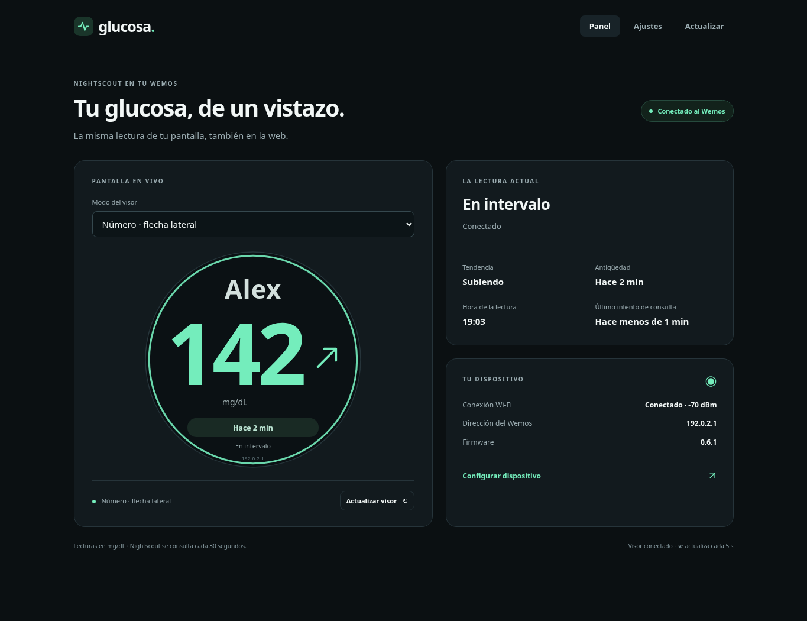
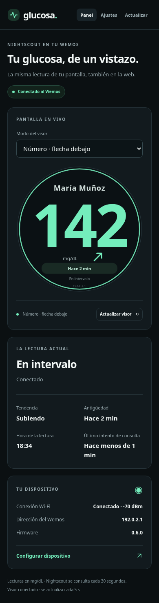
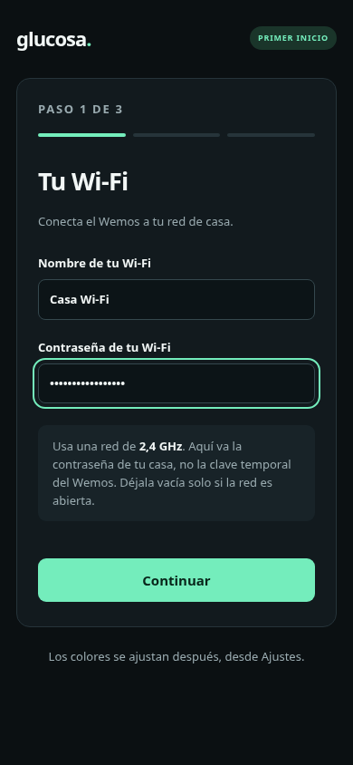
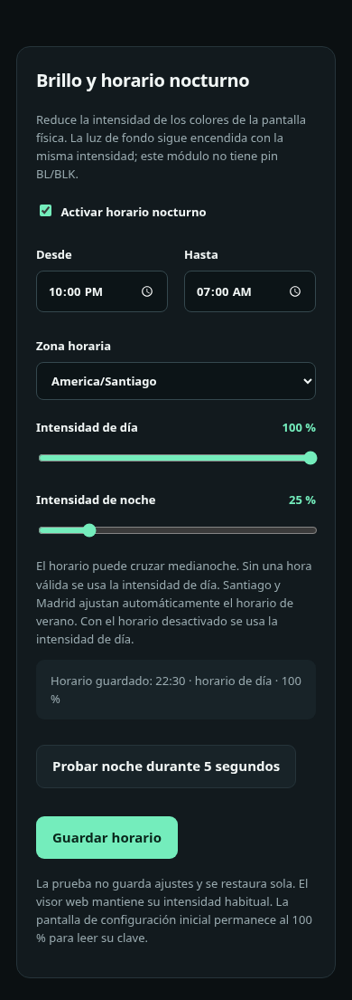
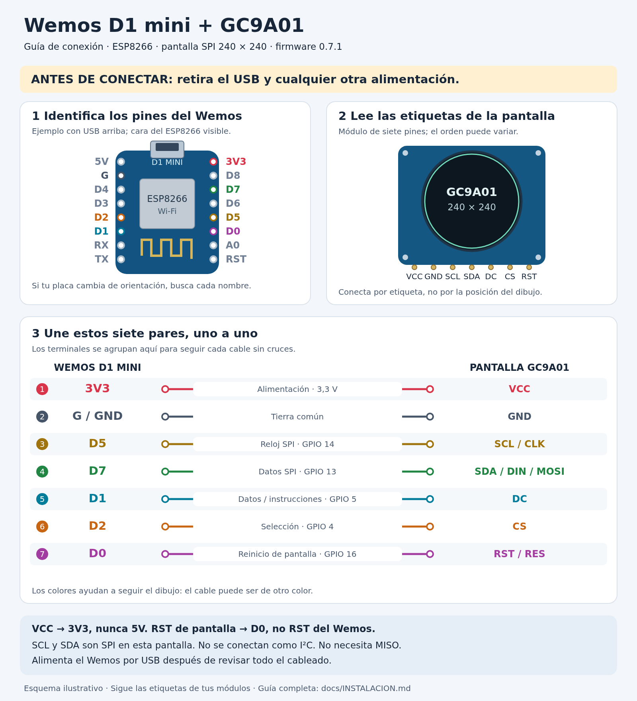

# Glucosa de un vistazo

**Español** · [English](README.en.md)

Un pequeño visor de escritorio para ver las lecturas de glucosa de **Nightscout**
en una pantalla redonda y, también, desde el navegador del teléfono o computador.
Muestra el número, una flecha de tendencia y cuánto tiempo tiene la lectura,
con una interfaz oscura y letras grandes.

La versión actual funciona con **Wemos D1 mini ESP8266 y pantalla GC9A01 de
240 × 240 píxeles**. El soporte para ESP32 es parte de la evolución futura y
todavía no está implementado.

## Para comenzar

| Quiero… | Dónde ir |
| --- | --- |
| Armarlo y dejarlo funcionando | [Guía de instalación paso a paso](docs/INSTALACION.md) |
| Ver qué cable va en cada pin | [Diagrama nuevo y tabla de conexiones](docs/INSTALACION.md#2-conectar-la-pantalla) |
| Descargar el programa del dispositivo | [Firmware 0.8.1 para D1 mini](firmware/README.md) |
| Obtener la clave pública de mi sitio, si la necesito | [Herramientas con ventana para Windows, Linux y macOS](tools/key-export/README.md) |
| Conocer lo que viene, incluido ESP32 | [Hoja de ruta](ROADMAP.md) |
| Compilar, revisar HTTPS o colaborar con código | [Referencia técnica](docs/REFERENCIA-TECNICA.md) |

## Qué necesitas y cómo funciona

[Nightscout](https://nightscout.github.io/) es un proyecto que permite consultar
datos de glucosa desde un servidor web. Este dispositivo toma las lecturas de
**un Nightscout que ya esté funcionando**; puede ser el tuyo o uno al que tengas
acceso autorizado, por ejemplo el de una persona a la que acompañas.

El recorrido es: **sensor y sistema que sube sus datos → Nightscout → Wi-Fi de
casa → Wemos y pantalla**. El navegador se conecta al Wemos para mostrar una copia
del visor y cambiar sus ajustes. El Wemos no se comunica directamente con el sensor.

Para montarlo necesitas la placa, la pantalla, siete cables, alimentación por USB,
una red Wi-Fi de **2,4 GHz** y la dirección de Nightscout. Un computador se usa para
cargar el programa por USB la primera vez. Después, la configuración y las
actualizaciones se hacen desde la web del dispositivo.

## Funcionalidades actuales

| Función | Qué permite hoy |
| --- | --- |
| Español / English | Un solo firmware, con idioma guardado para pantalla y web; selector en el inicio y en Ajustes. |
| Lectura en pantalla y web | Glucosa en **mg/dL**, flecha de tendencia, antigüedad y estado de conexión. |
| Tres formas de verla | Número con gráfica de **30 minutos**, número grande con flecha lateral o número centrado con flecha debajo. |
| Nombre de la persona | Hasta 24 caracteres, con letra grande; los nombres largos se acortan visualmente. |
| Colores a elección | Cinco temas: menta, rojo, azul, rosado y celeste; también colores personalizados con comprobación de contraste. |
| Configuración desde el teléfono | Asistente de tres pasos para Wi-Fi, Nightscout y acceso de administración. |
| Bienvenida al encender | Indica el avance real de Wi-Fi, servidor y primera lectura. |
| Horario nocturno | Horas de inicio y fin, zona horaria e intensidad de día/noche entre 10 y 100 %, con prueba de cinco segundos. |
| Conexión con Nightscout | URL configurable, token de solo lectura cuando hace falta y HTTPS con certificados públicos o clave pública fija. |
| Actualizaciones por Wi-Fi | Carga de un archivo `.bin` desde el navegador; una actualización normal conserva los ajustes. |
| Recuperación y diagnóstico | Reconexión de Wi-Fi, conservación de la última lectura con avisos y página de diagnóstico. |

**El horario nocturno atenúa los colores dibujados, no la luz de fondo.** El módulo
de siete pines utilizado no permite controlar esa luz por separado. El visor web
mantiene su intensidad habitual.

## Pantallas y personalización

Número centrado en el teléfono, configuración inicial y horario nocturno:

[Ver también el visor con gráfica de 30 minutos](docs/images/visor-grafica.png).

Son capturas de la interfaz web del proyecto con **nombres y lecturas de ejemplo**;
no son fotografías de la pantalla física ni datos de un paciente. Algunas capturas
del visor muestran la versión 0.6.1, en la que se incorporó el nombre grande;
el horario nocturno pertenece a 0.7.1. Puedes abrir cada imagen para verla completa.
Los [diseños originales del visor](docs/propuestas-visor/README.md) y de
[bienvenida y configuración](docs/propuestas-inicio/README.md) quedan como referencia.

## Alcance y límites del sistema

- **Es un visor informativo.** No sustituye al sistema médico del sensor, no controla
  insulina ni ofrece alarmas clínicas garantizadas. No incluye alarmas sonoras o
  notificaciones al teléfono.
- **Necesita datos y conexión.** El Wemos consulta Nightscout cada 30 segundos; la
  llegada de nuevas mediciones depende del sensor y de quien las sube al servidor.
  La web consulta al Wemos cada cinco segundos. Si una conexión falla, el último
  dato puede seguir visible acompañado de su antigüedad y un aviso.
- **El historial es breve.** La gráfica resume 30 minutos en hasta siete puntos.
  No almacena un registro permanente; lo vuelve a solicitar después de reiniciar.
  La fecha de una lectura no se utiliza como si fuera la hora actual.
- **Las unidades e intervalos son fijos.** Solo muestra mg/dL; marca valores inferiores
  a 70 o superiores a 180 y lecturas de diez minutos o más como antiguas. Son
  referencias visuales del programa, no objetivos de tratamiento personalizados.
- **La web es local.** Se abre en la misma red del Wemos, con usuario y contraseña.
  Usa HTTP dentro de esa red; la conexión con Nightscout usa HTTPS. No incluye
  acceso remoto propio y no debe publicarse el panel de administración en Internet.
- **El hardware soportado es específico.** D1 mini ESP8266 de 4 MB y el cableado
  indicado para GC9A01 SPI. No hay todavía firmware ESP32 ni compatibilidad general
  con otras pantallas.

La versión 0.8.1 tiene comprobaciones de compilación, lógica y navegador; la
verificación completa de esa versión en una placa física sigue pendiente.
Los detalles están en los [datos de compilación](firmware/build-info.json).

## Conexiones y documentación

El nuevo esquema muestra los siete cables, sus nombres y la alimentación a 3,3 V.
La [guía de instalación](docs/INSTALACION.md) explica cómo identificar los pines,
cargar el programa, configurar el teléfono y resolver los problemas habituales.

También se conserva el [primer diagrama sobre fotografía](docs/cableado-gc9a01.png)
como muestra del montaje original, sin reemplazarlo.

Para seguir el desarrollo: [hoja de ruta](ROADMAP.md),
[historial de implementación](docs/HISTORIAL.md) y
[referencia técnica](docs/REFERENCIA-TECNICA.md).
