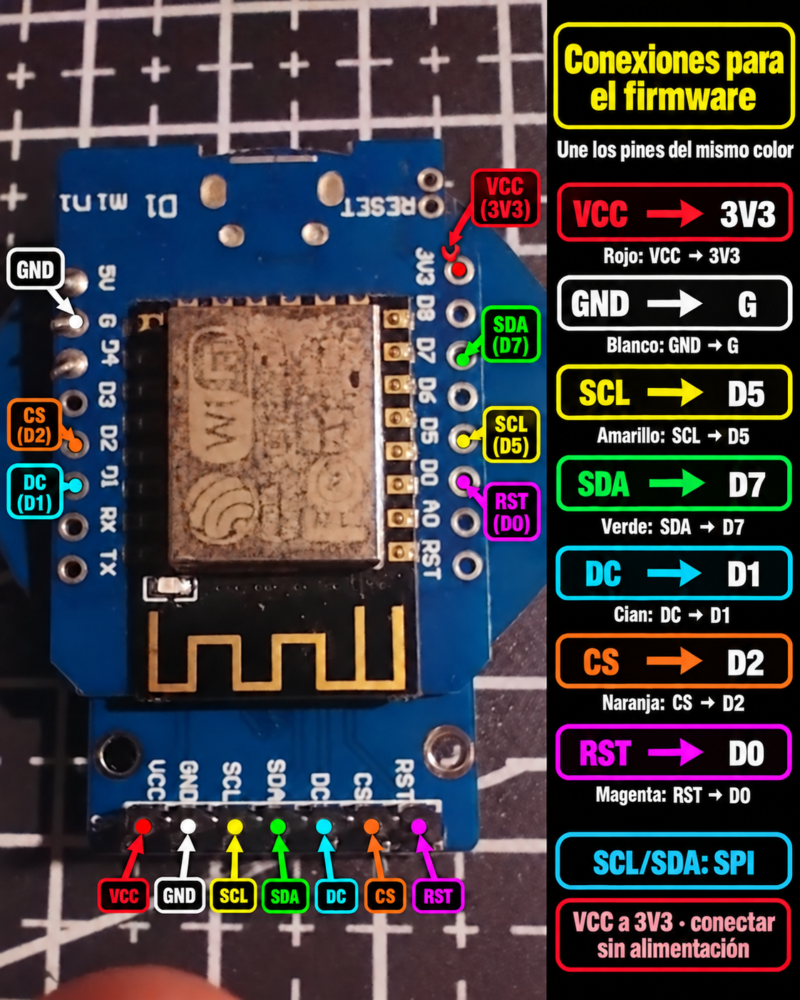
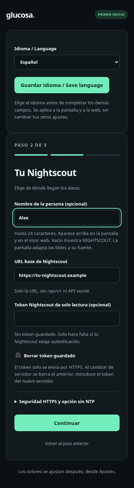

# Instalación paso a paso

**Español** · [English](INSTALLATION.en.md)

Esta guía sirve para **Wemos D1 mini con ESP8266 y 4 MB de memoria flash**, junto
con una pantalla circular **GC9A01 SPI de 240 × 240 y siete pines**. No necesitas
programar ni compilar el proyecto: usarás un archivo ya preparado.

Si el dispositivo ya tiene el programa y muestra una red `glucosa-…`, comienza
en el [paso 4: configuración inicial](#4-configurar-desde-el-teléfono).
Si ya funciona y solo quieres actualizarlo, ve a [actualización por Wi-Fi](#7-actualizar-por-wi-fi).

## 1. Preparar lo necesario

| Elemento | Para qué sirve |
| --- | --- |
| Wemos D1 mini ESP8266 de 4 MB | Es la placa que se conecta a Wi-Fi y consulta Nightscout. |
| Pantalla GC9A01 SPI de siete pines | Muestra la lectura; comprueba el modelo y las etiquetas del módulo. |
| Siete cables de conexión | Unen la placa y la pantalla. Los conectores deben coincidir con tus placas. |
| Cable USB **de datos** | Alimenta el Wemos y permite cargar el programa desde un computador. Un cable que solo carga no sirve para la primera instalación. |
| Computador con Windows, macOS o Linux | Se utiliza en la primera carga por USB. |
| Teléfono o computador con navegador | Permite configurar el equipo y abrir el visor web. |
| Wi-Fi de **2,4 GHz** con Internet | Es la red que usará el Wemos; no admite una red exclusivamente de 5 GHz. |
| Un servidor Nightscout con lecturas | Necesitas su dirección y, si es privado, un token con permiso de lectura. |

Los pines deben estar soldados o sujetos mediante una conexión eléctrica firme;
no basta con apoyar los cables en agujeros sin soldar. Para el uso diario se
alimenta el Wemos por USB. La pantalla recibe **3,3 V desde la placa**.

Nightscout debe estar instalado y recibiendo datos por otro medio. Esta guía
instala el visor, no el servidor Nightscout ni el sistema que envía datos del sensor.
Si aún no tienes servidor, puedes preparar y configurar el hardware, pero no
aparecerán mediciones hasta conectarlo a uno con lecturas disponibles.

## 2. Conectar la pantalla

**Desconecta el USB y cualquier otra alimentación antes de poner o mover cables.**
Busca los nombres impresos junto a los pines. En distintas placas pueden cambiar
el orden, la posición y la orientación del conector.

[](images/conexiones-wemos-gc9a01.png)

[Ver en tamaño completo](images/conexiones-wemos-gc9a01.png) ·
[Versión vectorial para ampliar o imprimir](images/conexiones-wemos-gc9a01.svg)

Haz estas **siete conexiones**, una por una:

| N.º | Etiqueta en la pantalla | Conectar al Wemos | Qué hace |
| --- | --- | --- | --- |
| 1 | **VCC** | **3V3** | Alimentación de la pantalla a 3,3 V. |
| 2 | **GND** | **G** o **GND** | Tierra, la referencia eléctrica común. |
| 3 | **SCL** o **CLK** | **D5** | Reloj de la comunicación SPI. |
| 4 | **SDA**, **DIN** o **MOSI** | **D7** | Datos enviados a la pantalla. |
| 5 | **DC** | **D1** | Distingue instrucciones de datos. |
| 6 | **CS** | **D2** | Selecciona la pantalla. |
| 7 | **RST** o **RES** | **D0** | Reinicia la pantalla desde el programa. |

Tres detalles evitan los errores más comunes:

- **VCC va a 3V3, no a 5V**, para el módulo de esta guía. El USB alimenta la placa;
  no se conecta directamente a VCC de la pantalla.
- **RST de la pantalla va a D0 del Wemos**, no al pin RST de la placa.
- Aquí **SCL y SDA son señales SPI**. Aunque sus nombres recuerden a otras
  pantallas, no se conectan como I²C. Este módulo no necesita un cable MISO.

Usa las etiquetas **D5, D7, D1, D2 y D0** impresas en el Wemos. D1 no significa
GPIO 1: para quien necesite los números internos, corresponden a GPIO 14, 13,
5, 4 y 16, respectivamente. El diagrama agrupa las conexiones por nombre; no
convierte el orden de los pines en un estándar universal.

Antes de enchufar, repasa la tabla, comprueba que ningún cable toque dos pines
y procura usar cables cortos. Si tu pantalla tiene BL/BLK u otros pines, revisa
su documentación: es otra variante y este esquema no define su alimentación
ni el control de su luz de fondo.

### El primer diagrama, conservado como muestra

El [diagrama original sobre la fotografía](cableado-gc9a01.png) sigue disponible
sin modificaciones. Muestra el montaje que dio origen al proyecto. Para una
conexión nueva usa el esquema y la tabla anteriores, verificando las etiquetas
de tus placas.

<details>
<summary>Ver la muestra original</summary>



</details>

## 3. Cargar el programa por USB, solo la primera vez

El **firmware** es el programa que ejecuta la placa. Se distribuye como un archivo
con terminación `.bin`. La versión disponible es **0.8.0** para D1 mini ESP8266.

1. Abre [nightscout-d1-mini-v0.8.0.bin](../firmware/nightscout-d1-mini-v0.8.0.bin)
   en GitHub y pulsa **Download raw file** o el botón de descarga del archivo.
2. Guarda el `.bin` en una carpeta fácil de encontrar. El ZIP del repositorio y
   los ZIP de las herramientas de claves **no son firmware**.
3. Conecta el Wemos al computador con el cable USB de datos. La pantalla ya debe
   estar cableada como indica el paso anterior.

El archivo no contiene nombres, Wi-Fi, tokens ni contraseñas de usuarios. No es
necesario modificarlo antes de cargarlo.

### En Windows: opción con ventana

Puedes usar **Flash Download Tools de Espressif**, disponible en su
[página oficial de herramientas](https://www.espressif.com/en/support/download/other-tools).
El aspecto y los nombres de las opciones pueden variar entre versiones.

1. Extrae y abre la herramienta; selecciona **ESP8266** y el modo normal de
   desarrollo si pregunta por el tipo de chip o de trabajo.
2. En la primera fila, elige el `.bin`, activa la casilla de esa fila y escribe
   **`0x00000`** como dirección de carga.
3. Configura **SPI MODE: DIO**, tamaño **4 MB / 32 Mbit** y velocidad de flash
   **40 MHz** si la versión de la herramienta muestra estos campos.
4. Elige el **puerto COM** del Wemos y una velocidad de carga de **115200**.
   El puerto aparece en el Administrador de dispositivos de Windows, en
   **Puertos (COM y LPT)**, al conectar la placa.
5. Pulsa **START** y espera que termine sin errores. Desconecta y vuelve a conectar
   el USB para arrancar el programa si la herramienta no lo reinicia.

No hace falta usar una función de borrado completo. Ese borrado elimina también
los ajustes que pudieran estar guardados.

### En Windows, macOS o Linux: opción por terminal

Esta alternativa usa **Python 3** y `esptool`, la herramienta de carga. Instala
Python desde [python.org](https://www.python.org/downloads/) si no lo tienes.
En Linux puedes utilizar el gestor de paquetes de tu distribución; el componente
`venv` también debe estar disponible.

Abre una terminal **en la carpeta donde guardaste el `.bin`**. Puedes encontrar
la opción de abrir una terminal desde el explorador de archivos. Copia únicamente
los comandos de tu sistema; el texto `COM3` o `/dev/ttyUSB0` es un ejemplo y debes
reemplazarlo por el puerto de tu placa.

**Windows (PowerShell o CMD):**

```powershell
py -m venv .venv-flasheo
.\.venv-flasheo\Scripts\python.exe -m pip install esptool==4.8.1
.\.venv-flasheo\Scripts\python.exe -m esptool --chip esp8266 --port COM3 --baud 115200 write_flash --flash_mode dio --flash_size 4MB 0x00000 nightscout-d1-mini-v0.8.0.bin
```

**Linux:**

```bash
python3 -m venv .venv-flasheo
.venv-flasheo/bin/python -m pip install esptool==4.8.1
.venv-flasheo/bin/python -m esptool --chip esp8266 --port /dev/ttyUSB0 --baud 115200 write_flash --flash_mode dio --flash_size 4MB 0x00000 nightscout-d1-mini-v0.8.0.bin
```

**macOS:** usa los mismos dos primeros comandos de Linux. Para localizar el
puerto, ejecuta `ls /dev/cu.*` antes y después de conectar la placa. Sustituye
el puerto del siguiente ejemplo por el nuevo que aparezca:

```bash
.venv-flasheo/bin/python -m esptool --chip esp8266 --port /dev/cu.usbserial-0001 --baud 115200 write_flash --flash_mode dio --flash_size 4MB 0x00000 nightscout-d1-mini-v0.8.0.bin
```

Los D1 mini habituales entran automáticamente en modo de carga. Si no aparece
un puerto, prueba otro cable de datos y revisa si tu variante necesita el
controlador USB CH340 o CP210x del fabricante. Si el puerto está ocupado, cierra
el monitor serie u otra herramienta que lo esté usando. En Linux, un error
`Permission denied` puede requerir acceso al grupo del puerto serie de tu
distribución y volver a iniciar sesión.

**Resultado esperado:** la carga termina correctamente, el Wemos reinicia y la
pantalla muestra instrucciones para conectarse a una red `glucosa-…`. Si ya tenía
ajustes válidos, intentará conectarse directamente a la red guardada.

## 4. Configurar desde el teléfono

### Conectarte a la red temporal del Wemos

1. En el teléfono o computador, busca la red **`glucosa-XXXXXX`** que indica la pantalla.
2. Usa la **contraseña de 12 caracteres que muestra esa misma pantalla**.
   Se genera para el modo de configuración; no es una contraseña fija.
3. Mantén la conexión aunque el teléfono avise que **no hay Internet**. Si cambia
   automáticamente a otra red o a datos móviles, vuelve a conectarlo a `glucosa-…`.
4. Abre el navegador y escribe **`http://192.168.4.1/`**, incluyendo `http://`.
   No hace falta esperar que se abra una ventana automática.

Hay tres contraseñas distintas durante la instalación:

| Contraseña | Cuál usar |
| --- | --- |
| Para entrar a `glucosa-…` | La que aparece en la pantalla del dispositivo. |
| Para conectar el Wemos a tu casa | La de tu Wi-Fi habitual. |
| Para administrar el visor | Una nueva que eliges tú en el último paso del asistente. |

### Elegir idioma

En **Idioma / Language** puedes elegir **Español** o **English** y pulsar
**Guardar idioma / Save language**. El cambio se guarda y se aplica a la pantalla
física y a la web, sin reiniciar ni cambiar los otros ajustes guardados. Elige
antes de completar el formulario: guardar idioma recarga la página y se pierden
los campos que todavía no guardaste. Funciona también sin JavaScript.

En equipos actualizados desde una versión anterior comienza en español. Elegir
inglés no cambia mg/dL ni la zona horaria. Puedes volver a cambiarlo en Ajustes.

### Paso 1 del asistente: Tu Wi-Fi

Escribe el nombre exacto de tu red de casa y su contraseña. Debe ser una red de
**2,4 GHz**. Aquí no va la clave temporal que acabas de usar para `glucosa-…`.


### Paso 2 del asistente: Tu Nightscout

- **Nombre de la persona:** el título que aparecerá arriba del número; es opcional.
- **URL base:** solo la dirección del sitio, por ejemplo `https://tu-nightscout.example`.
  No agregues `/api/v1`, un token, un API secret ni parámetros a la dirección.
  La dirección de ejemplo no es un servidor de pruebas.
- **Token:** si el Nightscout es privado, utiliza un token con permiso de **solo
  lectura**, proporcionado por quien administra ese servidor. No necesitas su
  `API_SECRET` de administrador. Si permite lectura pública, deja el token vacío.
- **HTTPS:** para un sitio con certificado público normal, deja vacía la sección
  opcional de CA o clave pública. El firmware ya incluye certificados de confianza.
  Si necesitas la opción sin NTP, consulta el [apartado de HTTPS y hora](#8-https-hora-y-clave-pública).



### Paso 3 del asistente: Tu acceso

Elige un usuario y una **contraseña de administración de 12 a 64 caracteres**.
Anótalos: serán los que pida la web del Wemos. Son independientes del acceso a
Nightscout y de la contraseña de tu Wi-Fi.

Revisa el resumen y pulsa **Guardar y reiniciar**. Puedes volver atrás sin perder
los campos durante esa visita; solo el botón final guarda. El resumen no muestra
las contraseñas ni el token.

[Ver la captura de revisión final](images/configuracion-resumen.png).

### Volver a tu Wi-Fi habitual

Al reiniciar, el Wemos deja la red temporal y se conecta a tu casa. Reconecta
también el teléfono a tu Wi-Fi habitual y espera la primera lectura.
La bienvenida indica las etapas de Wi-Fi, servidor y lectura.

## 5. Abrir el visor web

Mira la **IP** que aparece abajo en la pantalla del Wemos, por ejemplo `192.168.1.50`.
En un teléfono o computador de la misma red, abre **`http://192.168.1.50/`** y usa
el usuario y la contraseña de administración que elegiste. Sustituye esa IP de
ejemplo por la de tu equipo: puede cambiar si el router la reasigna.

También puedes probar `http://glucosa-display.local/`; depende de que tu red
admita ese nombre. Si no abre, usa la IP. La dirección `192.168.4.1` se utiliza
solamente en el modo de configuración inicial.

El visor web muestra la misma lectura, flecha, antigüedad e historial que la
pantalla. El Wemos consulta Nightscout cada **30 segundos** y el navegador consulta
el estado del Wemos cada **cinco segundos**. **Actualizar visor** actualiza esa
copia local; no obliga al sensor ni a Nightscout a generar una medición nueva.

La lectura se marca **ANTIGUA** al tener diez minutos o más. Si se pierde una
conexión, puede quedar el último valor con un aviso. Revisa siempre la antigüedad
y el estado; un número visible por sí solo no confirma una conexión actual.

## 6. Personalizar y cambiar ajustes

| Dónde | Qué puedes cambiar |
| --- | --- |
| Panel → Modo del visor | Gráfica de 30 minutos, flecha lateral o flecha debajo. Se aplica también a la pantalla física. |
| Ajustes → Idioma / Language | Español o English para ambas interfaces, guardado al reiniciar. |
| Ajustes → Nombre de la persona | Hasta 24 caracteres; vacío vuelve a mostrar NIGHTSCOUT. Los nombres largos se acortan en el visor. |
| Ajustes → Apariencia | Menta, rojo, azul, rosado, celeste o colores personalizados con vista previa y validación de contraste. |
| Ajustes → Brillo y horario nocturno | Intensidad de día/noche, horario y zona horaria; incluye prueba temporal. |
| Ajustes → Servidor | URL, token y, si hace falta, CA o clave pública fija. |
| Configurar Wi-Fi y contraseñas | Cambiar la red o los datos de administración. Debes volver a introducir la contraseña Wi-Fi y elegir la de administración; guardar reinicia. |

### Horario nocturno

Está **desactivado por defecto**. Puedes activarlo, elegir tu zona horaria y definir,
por ejemplo, **22:00 a 07:00**, día al **100 %** y noche al **25 %**. Se admiten
intensidades entre 10 y 100 %. Pulsa **Guardar horario** para conservarlo.

**Probar noche durante 5 segundos** permite verlo sin guardar; vuelve solo al
estado anterior aunque cierres el navegador. Si no hay hora sincronizada, se
usa la intensidad de día y aparece un aviso. Con el horario desactivado, ajustar
la intensidad de día permite atenuar el contenido manualmente.

Se reducen los colores del número, flecha, textos, gráfica y fondo de la pantalla
física. **La luz de fondo sigue igual**, porque este módulo no tiene pin BL/BLK.
El visor web conserva su intensidad normal. En configuración inicial, la pantalla
permanece al 100 % para que se pueda leer la clave temporal.


### Cambiar de Nightscout o quitar un token

Al cambiar la URL a otro origen —protocolo, dominio o puerto— se borran el token
y la CA o clave propia anteriores para no usarlos en otro servidor. Introduce
los del nuevo sitio en ese mismo formulario si los necesita.

Para el mismo origen, dejar vacío un token o PEM **conserva el valor guardado**.
Para quitarlo debes marcar **Borrar token guardado** o **Borrar CA o clave fija y
usar certificados públicos**, según corresponda. No marques borrar al introducir
un token o una clave nuevos.

## 7. Actualizar por Wi-Fi

Una vez instalado, no necesitas volver a usar USB para las actualizaciones normales.

1. Descarga el `.bin` para **tu placa** desde [firmware](../firmware/README.md).
2. Abre la web del Wemos y pulsa **Actualizar**.
3. En el formulario **Firmware**, selecciona el archivo `.bin` y envíalo.
   **No uses FileSystem**: el proyecto ya lleva la interfaz web dentro del firmware.
4. Mantén la alimentación y espera el reinicio. Abre otra vez la web, comprueba
   la versión y espera que recupere las lecturas.

Una actualización normal conserva Wi-Fi, Nightscout, token, clave HTTPS, nombre
y apariencia. El horario nocturno se incorpora desde 0.7.1, inicialmente desactivado.
Un **borrado completo de memoria** elimina los ajustes; no forma parte de esta operación.

Hazlo desde una red local de confianza. No abras el panel ni su puerto en Internet.
Esta versión no tiene reversión automática: si una carga no consigue arrancar,
puede ser necesario repetir la carga por USB.

## 8. HTTPS, hora y clave pública

**HTTPS** protege la conexión entre el Wemos y Nightscout. No necesitas crear
un certificado para el dispositivo ni comprar uno. Estas son las dos opciones
habituales; la configuración de una CA privada se explica en la
[referencia técnica](REFERENCIA-TECNICA.md#https-y-autenticación).

### Opción habitual: certificados públicos incluidos

Deja vacío el campo opcional de certificado o clave. El Wemos verifica que el
certificado corresponda al sitio y sea válido. Para ello necesita saber la hora.
Intenta obtenerla por NTP, un servicio de hora de Internet.

Si queda en **Esperando hora NTP**, abre **Ajustes → Hora del dispositivo**:

1. Comprueba que la fecha y hora del teléfono o PC sean correctas.
2. Prueba **Reintentar NTP**.
3. Si no responde, pulsa **Usar hora de este teléfono/PC**.

Algunas redes bloquean NTP. Los servidores utilizados son `pool.ntp.org`,
`time.google.com` y `time.cloudflare.com`, por UDP 123. No necesitas abrir puertos
entrantes. El Wemos no tiene reloj con batería: si sigue bloqueado NTP, tendrás
que volver a darle la hora después de reiniciarlo.

### Alternativa: clave pública fija del servidor, sin depender de NTP

Es la opción para identificar el sitio por su clave en lugar de validar sus
certificados desde el Wemos. **No es el token ni una contraseña.**

1. Desde un computador de confianza con fecha correcta, abre las
   [herramientas con ventana](../tools/key-export/README.md). Elige el ZIP para tu
   sistema, extráelo y sigue sus instrucciones.
2. Introduce la URL HTTPS de tu Nightscout. La herramienta verifica el sitio y
   genera un `.txt` con su clave pública, listo para copiar. No necesita el token.
3. En la web del Wemos, abre **Ajustes → Seguridad HTTPS y opción sin NTP**.
4. Pega **todo el contenido** del `.txt`, incluyendo las líneas
   `-----BEGIN PUBLIC KEY-----` y `-----END PUBLIC KEY-----`.
5. Pulsa **Guardar servidor**, dejando **sin marcar** la casilla de borrar la clave.

La conexión sigue cifrada y el servidor debe demostrar que posee la clave
correspondiente. En este modo el Wemos **no comprueba la cadena de certificados,
el nombre ni las fechas del certificado**; comprueba la clave que guardaste.
Por eso se obtiene primero desde un computador que sí verifica el sitio.
Nunca pegues una clave privada ni una clave tomada de una conexión sin verificar.

Una renovación del certificado puede conservar la misma clave, y entonces no
necesitas cambiarla. Si el servidor cambia de clave, la conexión se detiene:
tendrás que repetir la extracción y guardarla de nuevo. No se aceptan claves
nuevas automáticamente.

Después de autenticar HTTPS, el Wemos puede tomar la hora de la cabecera de la
respuesta del servidor. **La fecha de una medición no sirve como hora actual**,
porque esa medición podría ser antigua. Si el servidor no entrega una hora válida,
se indica **Hora sin sincronizar**; puedes usar la hora del teléfono o PC.

## 9. Si algo no funciona

| Síntoma | Qué revisar primero |
| --- | --- |
| El computador no encuentra la placa | Cable USB de datos, otro puerto, controlador USB de tu variante y puerto COM/serie seleccionado. |
| La pantalla no muestra nada o queda blanca | Desconecta la alimentación y repasa los siete cables, las soldaduras y el modelo GC9A01. VCC → 3V3, SCL → D5, SDA → D7, DC → D1, CS → D2, RST → D0. |
| No aparece `glucosa-…` | Si ya tenía ajustes, intenta conectarse al Wi-Fi guardado. Mira si la pantalla muestra una IP. |
| El teléfono dice «Sin Internet» al configurar | Es normal en la red temporal. Mantén la conexión y abre `http://192.168.4.1/`. |
| No conecta a la red de casa | Nombre y contraseña exactos, Wi-Fi de 2,4 GHz, señal y alimentación estables. Acerca el equipo al router. |
| Ya no abre la web | Usa la IP actual de la pantalla y `http://`; teléfono y Wemos deben estar en la misma red y poder comunicarse. Una red de invitados puede aislarlos. |
| Dice «Esperando hora NTP» | Usa el apartado de HTTPS y hora anterior; la web local sigue disponible. |
| HTTP 401 o 403 al consultar Nightscout | URL, token y permisos de lectura en ese servidor. El usuario del Wemos no reemplaza al token Nightscout. |
| No hay lecturas o son antiguas | Revisa el propio Nightscout y el sistema que sube los datos. El visor no genera mediciones. |
| La gráfica no está completa | Solo resume 30 minutos y hasta siete puntos; los huecos grandes no se unen. Tras un error puede conservar una parte mientras reintenta. |
| Error TLS después de un cambio del sitio | Comprueba fecha/hora en modo de certificados. Si usas clave fija y el sitio la cambió, extrae y guarda la nueva con la herramienta. |
| «Este formulario ha caducado» | El Wemos cambió de sesión al reiniciarse o actualizarse. Abre Ajustes de nuevo, recarga la página y repite; no recuperes el formulario con Atrás. |
| La luz de fondo no baja de intensidad | Es lo esperado en este módulo: el horario atenúa los colores dibujados, no esa luz. |

### Recuperar la configuración Wi-Fi

Si al arrancar no logra conectarse a la red guardada durante un minuto, vuelve
al modo de configuración y muestra una nueva clave temporal. Para provocarlo
cuando necesitas cambiar una red que ya no puedes administrar desde la web,
puedes apagar temporalmente tu punto de acceso Wi-Fi y reiniciar el Wemos.
Cuando aparezcan la red temporal y su clave, vuelve a encender el punto de acceso
y configura el dispositivo desde el teléfono.

Un corte de Wi-Fi durante el uso normal provoca reintentos de conexión; no abre
el asistente automáticamente. El formulario del modo temporal permite elegir
nuevos datos de administración: para entrar necesitas la clave temporal que se
muestra físicamente en la pantalla. Esto también permite recuperar el acceso si
olvidaste tu contraseña de administración, sin empezar por un borrado completo.

### Datos útiles para pedir ayuda

Abre **`http://IP_DEL_WEMOS/diagnostics`** usando la IP real e inicia sesión.
Incluye versión, conexión, memoria y último error, sin contraseñas, tokens ni
lecturas de glucosa. Adjunta también el texto del error y el modelo de tus placas.
No compartas la configuración completa ni claves privadas. La
[referencia técnica](REFERENCIA-TECNICA.md) explica los campos de diagnóstico.

## Pequeño glosario

| Palabra | Significado en esta guía |
| --- | --- |
| Firmware / `.bin` | El programa que cargas en la placa. |
| URL base | La dirección principal de tu Nightscout, sin añadir rutas de API ni secretos. |
| IP del Wemos | La dirección local que muestra la pantalla para abrir su web. |
| Token | Credencial de Nightscout que autoriza leer datos; no es la contraseña del visor. |
| Clave pública | Identifica al servidor en el modo HTTPS opcional. No es una clave privada. |
| OTA | Actualización del programa por Wi-Fi, sin volver a usar USB. |

[Volver al proyecto](../README.md) · [Descarga del firmware](../firmware/README.md) ·
[Ver planes futuros](../ROADMAP.md)
