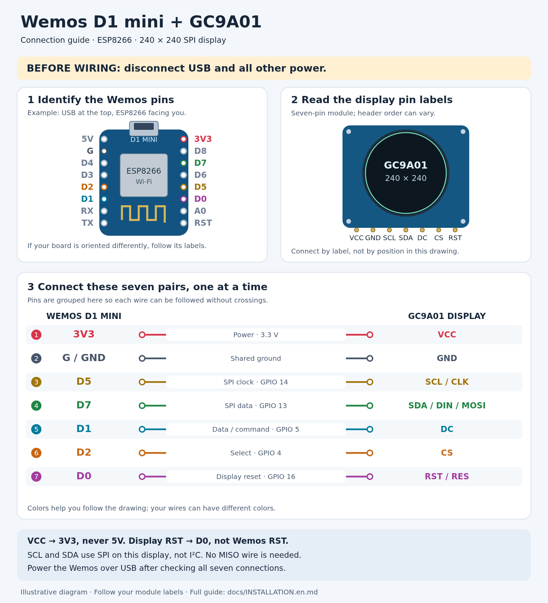
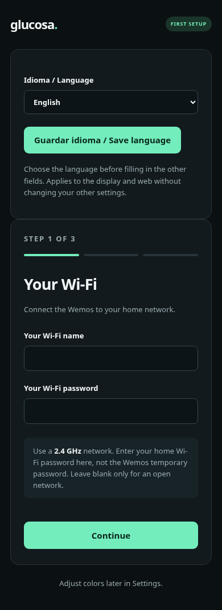

# Step-by-step installation

[Español](INSTALACION.md) · **English**

For **Wemos D1 mini ESP8266 with 4 MB flash** and a **seven-pin GC9A01 SPI
240 × 240 round display**. You use a ready-made program; no coding is required.

If your device already shows a `glucosa-…` network, start at
[phone setup](#4-set-up-from-your-phone). If it already works and you only need
an update, go to [wireless updates](#7-update-over-wi-fi).

## 1. Gather what you need

| Item | Purpose |
| --- | --- |
| Wemos D1 mini ESP8266, 4 MB | Connects to Wi-Fi and requests readings. |
| Seven-pin GC9A01 SPI display | Shows the readings; verify the controller and printed labels. |
| Seven jumper wires | Use connectors that fit your boards. |
| USB **data** cable | Powers the board and transfers the first firmware installation. Charge-only cables do not transfer data. |
| Windows, macOS or Linux computer | Needed for the first USB upload. |
| Phone or computer browser | Used for configuration and the web viewer. |
| **2.4 GHz** Wi-Fi with Internet | A 5 GHz-only network does not work with this board. |
| Existing Nightscout server | Needs available readings, its URL and a read-only token if private. |

Headers need soldering or another reliable electrical connection. Resting wires
in unsoldered holes is not sufficient. In daily use, USB powers the Wemos; the
display receives **3.3 V from the board**.

This guide installs the viewer, not Nightscout or the sensor uploader. Without
a server containing readings, you can prepare the hardware but will not get
measurements on the display.

## 2. Connect the display

**Disconnect USB and all other power before adding or moving wires.** Follow the
printed pin names. Header order and board orientation can vary between modules.

[](images/conexiones-wemos-gc9a01-en.png)

The pin names are the same on both language diagrams. Follow your actual boards' labels.
[Open full-size PNG](images/conexiones-wemos-gc9a01-en.png) ·
[Scalable SVG for printing](images/conexiones-wemos-gc9a01-en.svg).

Connect these **seven pairs**, one at a time:

| No. | Display label | Wemos label | Purpose |
| --- | --- | --- | --- |
| 1 | **VCC** | **3V3** | Display power, 3.3 V. |
| 2 | **GND** | **G / GND** | Shared ground. |
| 3 | **SCL / CLK** | **D5** | SPI clock, GPIO 14. |
| 4 | **SDA / DIN / MOSI** | **D7** | SPI data, GPIO 13. |
| 5 | **DC** | **D1** | Data/command selection, GPIO 5. |
| 6 | **CS** | **D2** | Display selection, GPIO 4. |
| 7 | **RST / RES** | **D0** | Display reset, GPIO 16. |

- **VCC goes to 3V3, not 5V**, for the module in this guide. USB powers the Wemos;
  it does not connect directly to the display's VCC.
- **Display RST goes to Wemos D0**, not the Wemos RST pin.
- These **SCL/SDA pins use SPI, not I²C**. No MISO wire is needed.
- Use the board's **D labels**. D1 is not GPIO 1.

Keep wires short, check solder joints and ensure no loose wire bridges two pins.
For a display with extra BL/BLK pins, consult its own specifications; this guide
does not define their power or backlight circuit.

The [original photo diagram](cableado-gc9a01.png) is preserved as a historical
example. For a new build, follow the current table and your board's labels.

## 3. Install firmware through USB the first time

**Firmware** means the program running on the board. It is delivered as a `.bin`
file. The current bilingual version is **0.8.0 for D1 mini ESP8266**.

1. Open [nightscout-d1-mini-v0.8.0.bin](../firmware/nightscout-d1-mini-v0.8.0.bin)
   on GitHub and select **Download raw file**.
2. Save it somewhere easy to find. A repository ZIP or key-tool ZIP is **not firmware**.
3. Connect the wired Wemos to the computer with a USB data cable.

The file contains no personal Wi-Fi credentials, tokens or administrator password.
You enter those later; you do not need to edit or compile it.

### Windows: graphical option

Use **Flash Download Tools** from
[Espressif's official tools page](https://www.espressif.com/en/support/download/other-tools).
Names and layout can vary by tool version.

1. Extract/open the tool and select **ESP8266**, with normal development mode if asked.
2. Select the `.bin` in the first row, enable its checkbox and set address **`0x00000`**.
3. Choose **SPI MODE: DIO**, **4 MB / 32 Mbit** and **40 MHz** flash frequency where offered.
4. Select the board's **COM port**, with upload speed **115200**. Windows Device
   Manager → **Ports (COM & LPT)** shows the port appearing when you connect it.
5. Select **START** and wait for success. Reconnect USB if the tool does not restart it.

A full erase is not needed; erasing the entire flash also deletes stored settings.

### Windows, macOS or Linux: terminal option

Install Python 3 from [python.org](https://www.python.org/downloads/) if needed.
On Linux, the distribution's package manager can supply Python and its `venv` component.

Open a terminal **in the folder containing your downloaded `.bin`**. Use only your
system's commands. Replace the example serial port with the port of your board.

**Windows, PowerShell or CMD:**

```powershell
py -m venv .venv-flash
.\.venv-flash\Scripts\python.exe -m pip install esptool==4.8.1
.\.venv-flash\Scripts\python.exe -m esptool --chip esp8266 --port COM3 --baud 115200 write_flash --flash_mode dio --flash_size 4MB 0x00000 nightscout-d1-mini-v0.8.0.bin
```

**Linux:**

```bash
python3 -m venv .venv-flash
.venv-flash/bin/python -m pip install esptool==4.8.1
.venv-flash/bin/python -m esptool --chip esp8266 --port /dev/ttyUSB0 --baud 115200 write_flash --flash_mode dio --flash_size 4MB 0x00000 nightscout-d1-mini-v0.8.0.bin
```

**macOS:** use the first two Linux commands. Run `ls /dev/cu.*` before and after
connecting the board to find its port, then substitute it below:

```bash
.venv-flash/bin/python -m esptool --chip esp8266 --port /dev/cu.usbserial-0001 --baud 115200 write_flash --flash_mode dio --flash_size 4MB 0x00000 nightscout-d1-mini-v0.8.0.bin
```

Typical D1 minis enter upload mode automatically. If no port appears, try another
data cable/USB port and check whether your board needs a manufacturer CH340 or
CP210x USB driver. Close other programs using the serial port. On Linux, a serial
`Permission denied` error can require membership in the distribution's serial-port
group, followed by signing in again.

**Expected result:** upload finishes, the board restarts and shows temporary
Wi-Fi instructions. If it already has valid settings, it tries the saved network instead.

## 4. Set up from your phone

### Join the temporary Wemos network

1. Find the **`glucosa-XXXXXX`** Wi-Fi network named on the round display.
2. Enter the **12-character password shown on that display**. It is generated
   for setup and changes when setup mode restarts.
3. Stay connected even if the phone says **no Internet**. Prevent it from
   automatically switching to another network or mobile data while configuring.
4. Open **`http://192.168.4.1/`**, including `http://`. Do not wait for an automatic portal.
5. At the top, choose **English** under **Idioma / Language** and press
   **Guardar idioma / Save language** before filling the other fields. The page
   reloads in English and the physical display changes too.

Language is saved across restarts and normal firmware updates. Switching language
reloads this page; any unsaved form entries need to be entered again. Other saved
settings are preserved. No JavaScript is required for language selection.



There are **three separate passwords**:

| Password | Use |
| --- | --- |
| Temporary `glucosa-…` network | The random password shown on the round display. |
| Home Wi-Fi | Your usual router/network password. |
| Wemos administration | A new password you choose at the last setup step. |

### Step 1: Your Wi-Fi

Enter the exact **2.4 GHz home network** name and its password. Do not use the
temporary Wemos password in this form. Leave the Wi-Fi password blank only for
an open network.

### Step 2: Your Nightscout

- **Person's name:** optional title above the number, up to 24 characters.
- **Nightscout base URL:** for example `https://your-nightscout.example`. This is
  an example, not a test server. Do not append `/api/v1`, a token, an API secret or query parameters.
- **Read-only token:** needed only if your Nightscout requires authentication.
  Ask its administrator for read permission; do not use the administrator `API_SECRET`.
- **HTTPS:** for a normal publicly trusted certificate, leave the optional CA/key
  section blank. Trusted public certificates are already included. If you need
  the option without NTP, see [HTTPS and time](#8-https-time-and-public-keys).

### Step 3: Your access

Choose an administrator username and a password of **12–64 bytes**. For ordinary
ASCII letters/numbers, a byte equals one character; accented letters can use more.
Keep these credentials: the viewer, settings and updates will request them.
They are separate from Nightscout and Wi-Fi credentials.

Review the summary and choose **Save and restart**. Back preserves fields during
this visit; only the final button saves. The summary hides passwords and token.

### Reconnect to your home Wi-Fi

The Wemos restarts and leaves its temporary network. Reconnect your phone to your
home Wi-Fi too. Startup shows real progress through Wi-Fi, server and first reading.

## 5. Open the web viewer

Find the **IP address** at the bottom of the round display, for example `192.168.1.50`.
From the same network, open **`http://192.168.1.50/`** and sign in with your Wemos
administrator credentials. Use your own displayed IP; the router may change it.

`http://glucosa-display.local/` may work if the network supports mDNS. Use the IP
if it does not. `192.168.4.1` is only the temporary setup address.

The web viewer copies the reading, trend, age and history. Nightscout is checked
every **30 seconds**; the browser checks the Wemos every **five seconds**.
**Refresh viewer** refreshes the local copy, not the sensor or Nightscout itself.

A reading at least ten minutes old is marked **OLD**. On a connection error, the
last number may remain visible with a warning. Always inspect age and status.
English selection keeps **mg/dL** units; it does not convert to mmol/L.

## 6. Personalize and change settings

| Location | Options |
| --- | --- |
| Dashboard → Display mode | 30-minute graph, side arrow or arrow below; applies to the physical display too. |
| Settings → Language | Spanish or English, saved for both interfaces. Does not change other saved preferences. |
| Settings → Person's name | Up to 24 characters; blank shows NIGHTSCOUT. Long names are visually shortened. |
| Settings → Appearance | Five themes or custom colors with preview and contrast checks. |
| Settings → Brightness and night schedule | Day/night intensities, times, time zone and a temporary preview. |
| Settings → Server | Base URL, token and optional CA/public key. |
| Wi-Fi and passwords | Change network/admin details; re-enter the Wi-Fi password and choose the admin password. Saving restarts. |

### Night schedule

Disabled by default. You can enable, for example, **22:00–07:00**, with day **100 %**
and night **25 %**. Intensities range from 10–100 %. Choose your **time zone**;
selecting English does not change the default Santiago zone. Save the schedule.

**Try night mode for 5 seconds** previews without saving and restores itself even
if you close the browser. Without valid time, day intensity is used with a notice.
With scheduling disabled, the day level acts as a manual content-intensity setting.

Only drawn colors are dimmed: number, arrow, text, graph and background.
**The backlight is unchanged.** The seven-pin module has no BL/BLK pin. The web
viewer stays at its usual intensity; temporary setup stays at 100 % for readability.

### Change server or remove a token/key

Changing HTTPS origin—protocol, domain or port—clears the old token and custom
CA/key, so they are not sent to another server. Enter the new server's credentials
in that form if needed.

For the same origin, a blank token/PEM field **keeps the saved value**. Use **Clear
saved token** or **Clear CA or pinned key and use public certificates** to remove
it. Do not select clear while entering a new value.

## 7. Update over Wi-Fi

1. Download the `.bin` for **your board** from [Firmware](../firmware/README.en.md).
2. Open the Wemos web page and select **Update**.
3. Choose the `.bin` in **Firmware**, not **FileSystem**.
4. Keep power connected and wait for restart. Reload the web page, confirm the
   new version and wait for readings to resume.

Normal updates retain Wi-Fi, server, credentials, name, appearance, schedule and
language. Upgrading an earlier version defaults language to Spanish; select
English in Settings. A full flash erase deletes saved settings and is not part
of a normal update.

Use a trusted local network. Do not expose the administration port to the Internet.
There is no automatic rollback in this version; a non-booting image may require USB recovery.

## 8. HTTPS, time and public keys

HTTPS protects the Wemos-to-Nightscout connection. You do not need to create or
buy a client certificate for this device.

### Usual option: included public certificates

Leave the optional CA/key blank. The Wemos verifies the server certificate chain,
name and dates, so it needs correct time. NTP provides time over the Internet.

If it waits for NTP, open **Settings → Device time**:

1. Check your phone/PC date and time.
2. Try **Retry NTP**.
3. If it still fails, select **Use this phone/PC's time**.

NTP uses `pool.ntp.org`, `time.google.com` and `time.cloudflare.com`, UDP 123.
Some networks block it. No inbound router ports are required. The Wemos has no
battery-backed clock, so manual time must be set again after restart if NTP remains blocked.

### Alternative: pinned public key, without depending on NTP

This identifies the server by a verified key. **It is not the token or a password.**

1. On a trusted computer with correct time, download the
   [English key-export tool](../tools/key-export/README.en.md) for your OS.
2. Extract/open it and enter only your Nightscout HTTPS URL. It verifies the site
   and creates a `.txt` public key. No token is needed.
3. Open **Settings → HTTPS security and option without NTP** on the Wemos.
4. Paste the entire TXT, including `-----BEGIN PUBLIC KEY-----` and
   `-----END PUBLIC KEY-----`.
5. Select **Save server**, leaving the clear-key checkbox **unchecked**.

Traffic remains encrypted and the server must prove it holds the corresponding
private key. In this mode the Wemos **does not check the certificate chain, name
or dates**; identity is pinned by key. The computer verifies the site before
exporting it. Never paste a private key or a key obtained over an unverified connection.

Certificate renewal can keep the same key, in which case no update is needed.
If the server rotates its key, the connection fails until you export and save
the new key. Unknown keys are not automatically accepted.

After authenticated HTTPS, time may come from a fresh server response's `Date`
header. **A reading timestamp is not the current time**: the reading may already
be old. If no valid server time is available, the viewer says **Clock not synchronized**;
you can use the phone/PC clock. Private-CA details are in the
[technical reference](TECHNICAL.en.md#https-and-authentication).

## 9. Troubleshooting

| Symptom | First checks |
| --- | --- |
| Computer cannot find the board | USB data cable, another port, USB driver for your variant and correct COM/serial selection. |
| Blank or white display | Disconnect power, check model, soldering and all seven wires. VCC → 3V3; SCL → D5; SDA → D7; DC → D1; CS → D2; RST → D0. |
| No `glucosa-…` network | Saved settings may already connect it to home Wi-Fi; look for an IP on the display. |
| Phone says no Internet during setup | Expected on the temporary network. Stay connected and open `http://192.168.4.1/`. |
| Cannot join home Wi-Fi | Exact name/password, 2.4 GHz, stable power and sufficient signal; move nearer the router. |
| Web page no longer opens | Current displayed IP, `http://`, same network and no guest-network device isolation. |
| Waiting for NTP | Use Device time as described above; the local web page remains accessible. |
| Nightscout HTTP 401/403 | Base URL, token and read permissions. Wemos login is not the Nightscout token. |
| No readings or old readings | Check Nightscout and the uploader. The viewer does not generate data. |
| Partial graph | Only 30 minutes/up to seven points are shown; large gaps are not joined. Partial history may be kept while retrying. |
| TLS failure after a site change | Check time in CA mode. If a pinned key changed, obtain and save a new verified key. |
| Expired form/session | Restart/update changed the session. Reopen Settings and reload; do not restore an old form using Back. |
| Backlight does not dim | Expected: this module dims content only. |
| Another open tab shows the old language | The dashboard reloads when it detects the saved language changed; reload other settings tabs manually. |

### Recover Wi-Fi or administration access

If the Wemos cannot connect to saved Wi-Fi for one minute after boot, it opens
temporary setup with a new on-screen password. If you cannot reach Settings,
you can temporarily switch off your Wi-Fi access point and restart the Wemos.
When temporary setup appears, switch the access point back on and configure
from your phone. The temporary form allows choosing new administrator credentials;
access requires the password physically shown on the display.

A Wi-Fi interruption during normal use triggers reconnection, not setup mode.
A full flash erase removes all settings and is a last resort.

### Ask for help

Open `http://YOUR_WEMOS_IP/diagnostics` and sign in. It reports firmware, connection,
memory and errors without passwords, tokens or glucose readings. Include the
exact error and your board/display model. Do not publish full configuration or
private keys. Diagnostic field names stay stable in English in either language.

## Short glossary

| Word | Meaning |
| --- | --- |
| Firmware / `.bin` | The program installed on the board. |
| Base URL | Main Nightscout address without API paths or secrets. |
| Wemos IP | Local address shown on the round display. |
| Token | Nightscout read credential, separate from viewer login. |
| Public key | Server identity in the optional pinned HTTPS mode. Not a private key. |
| OTA | A firmware update over Wi-Fi instead of USB. |

[Project](../README.en.md) · [Firmware](../firmware/README.en.md) ·
[Future plans](../ROADMAP.en.md)
