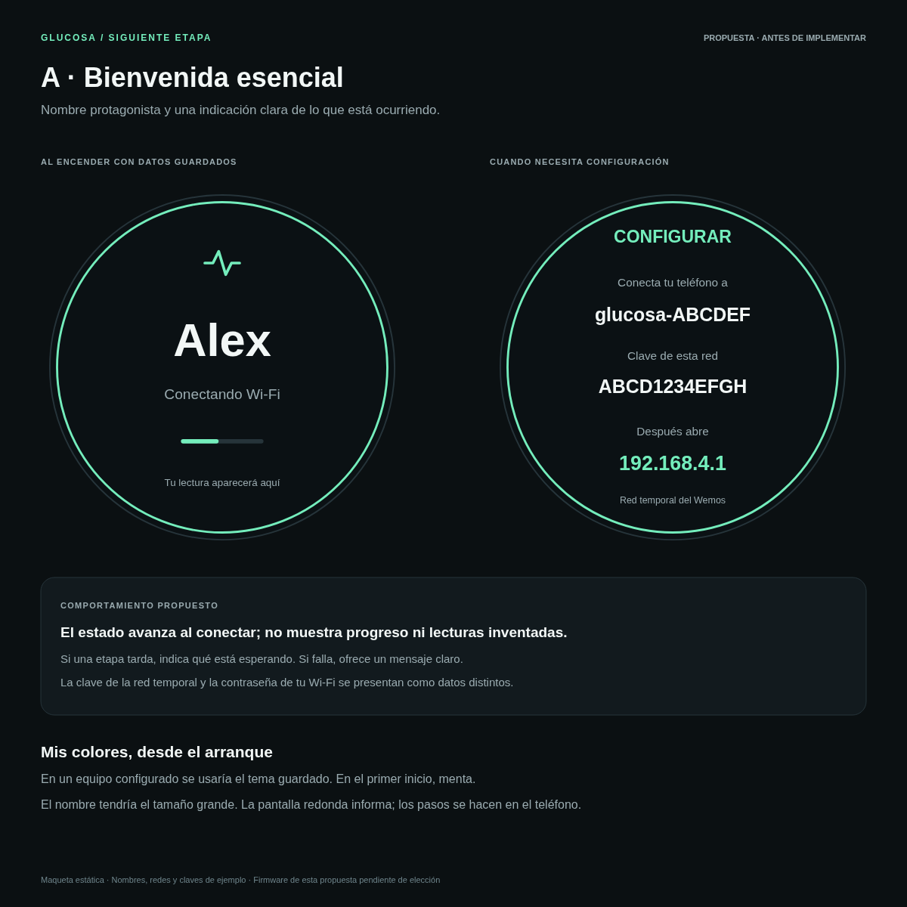
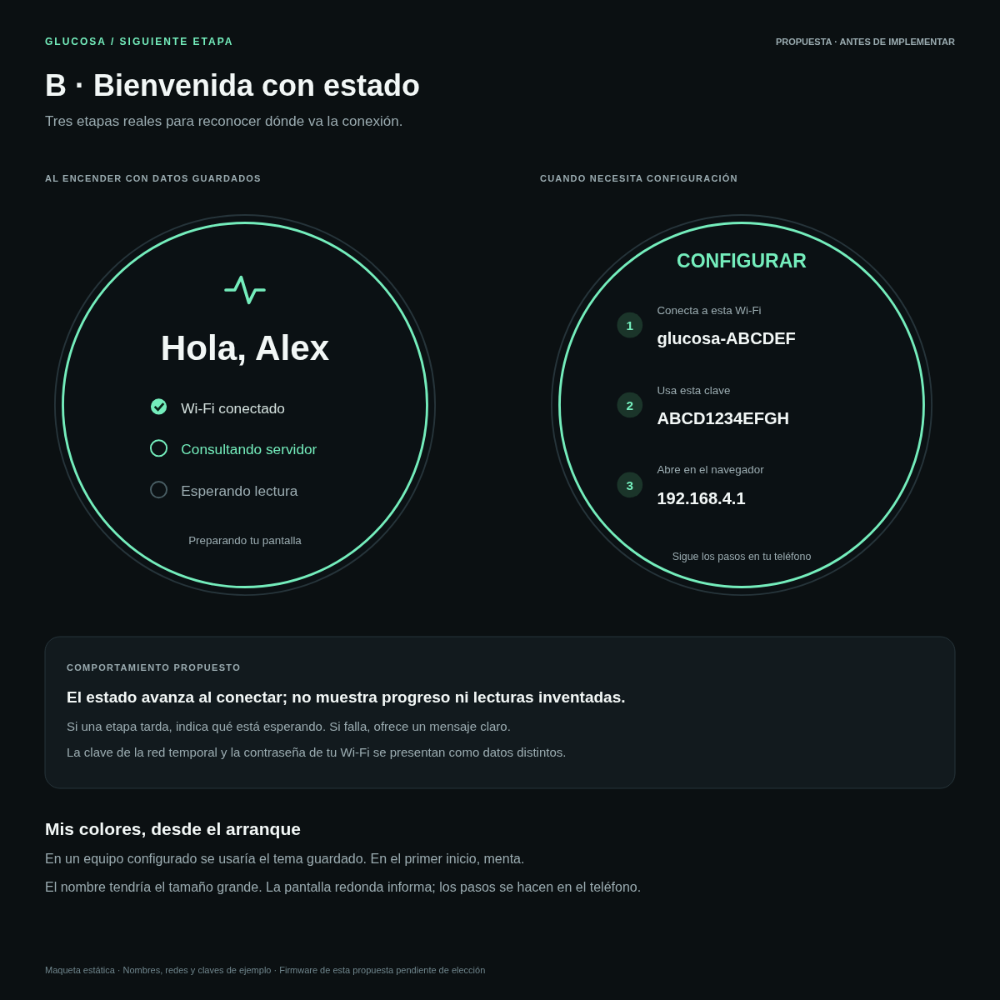
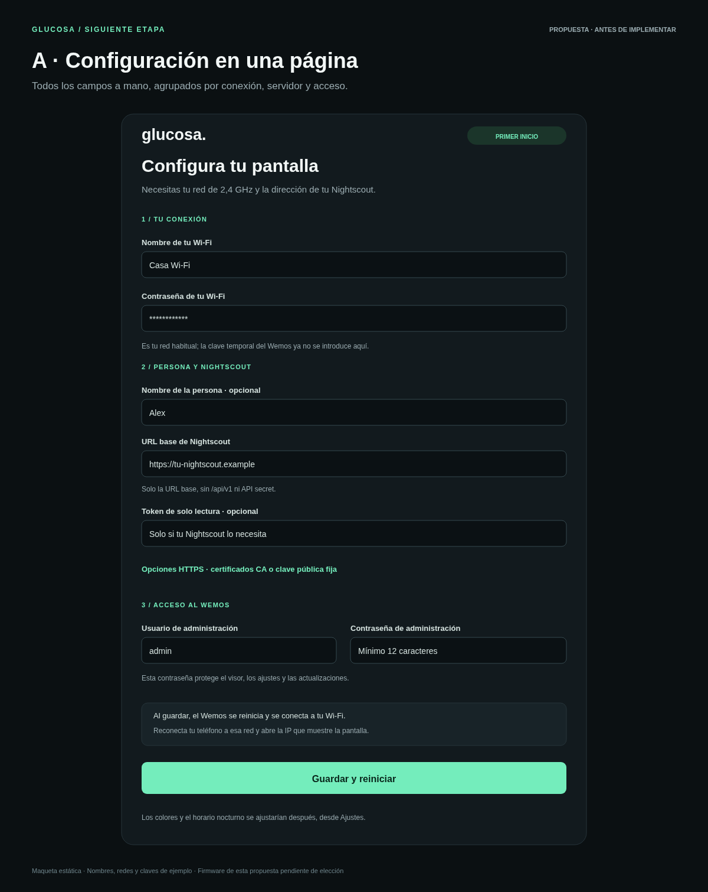
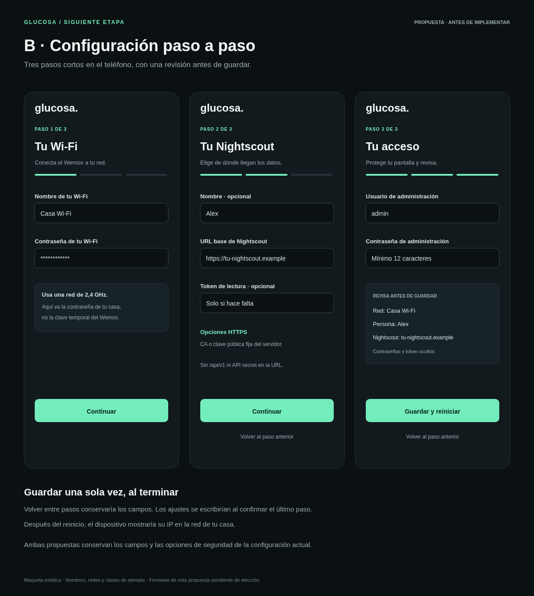
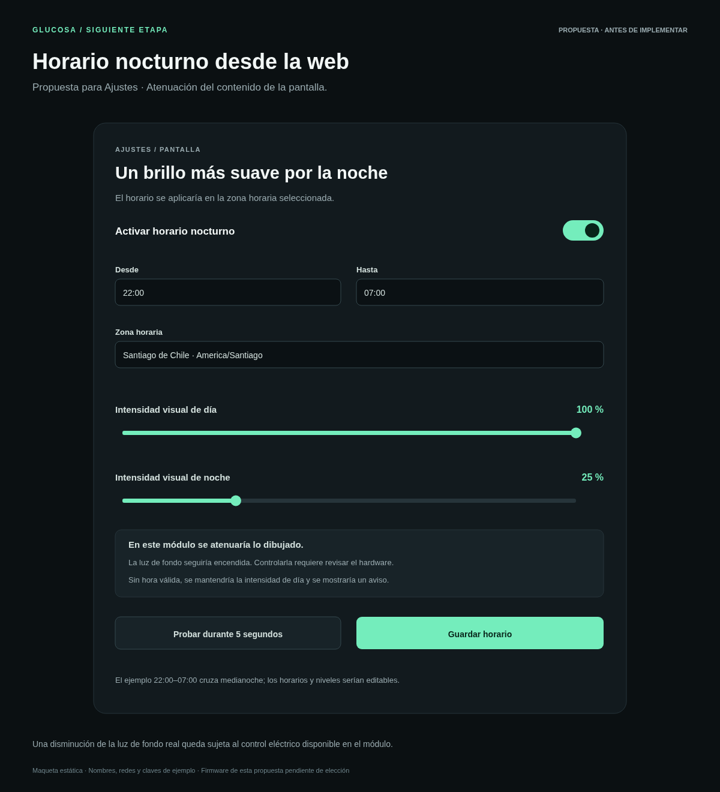

# Propuestas de bienvenida y configuración inicial

**Diseños B elegidos e implementados en el firmware 0.7.0.** Las imágenes de
esta carpeta conservan las maquetas originales; los nombres, redes, claves y
lecturas son ejemplos. El horario nocturno está implementado desde 0.7.1.
Las opciones de bienvenida y configuración se pueden combinar libremente.

| Pantalla | Opción A | Opción B |
| --- | --- | --- |
| Bienvenida del Wemos | [Esencial](bienvenida-a.png): nombre grande y estado actual | [Con etapas](bienvenida-b.png): Wi-Fi, servidor y primera lectura |
| Configuración inicial web | [Una página](configuracion-a.png): campos agrupados | [Paso a paso](configuracion-b.png): conexión, Nightscout y acceso |

La combinación elegida es **bienvenida B + configuración B**: permite ver
en qué etapa está el dispositivo y completar los datos en pasos breves.

## Bienvenida A · Esencial

Nombre protagonista y una indicación de conexión. Si necesita configuración,
muestra la red temporal, su clave y la dirección que hay que abrir en el teléfono.

## Bienvenida B · Con etapas

Muestra las etapas Wi-Fi, servidor y primera lectura. Los indicadores cambiarían
según el estado real; si falla una etapa, mostraría el motivo en ese lugar.
La pantalla informa y la configuración se hace desde el teléfono.

En ambas variantes se usaría el tema guardado; en el primer arranque, menta.
No se retendría la bienvenida con una espera artificial al estar lista la lectura.
El texto se ajustaría a los 240 × 240 píxeles y al círculo, con las fuentes
incluidas y sin reservar un framebuffer.

## Configuración A · Una página

Tres grupos: conexión Wi-Fi, persona y Nightscout, y acceso de administración.
Las opciones HTTPS se desplegarían cuando hagan falta. Al guardar se explicaría
el reinicio y cómo volver al dispositivo desde la red de casa.

## Configuración B · Paso a paso

Tres pantallas con posibilidad de volver conservando los campos. Solo se
escribirían los ajustes al terminar el último paso. La revisión final mostraría
red, nombre y servidor, con las contraseñas y el token ocultos.

Ambas opciones conservarían las validaciones, los campos HTTPS y la protección
de formularios actual. La URL base y el token seguirían en campos distintos.
La clave de la red temporal del Wemos se distinguiría de la contraseña del Wi-Fi
de casa y de la contraseña de administración.

## Horario nocturno desde la web

Horario e intensidad visual editables, con zona horaria, intervalo que puede
cruzar medianoche y una prueba de cinco segundos. Por ejemplo, 22:00–07:00,
100 % durante el día y 25 % durante la noche. Sin hora válida se mantendría
la intensidad de día y se mostraría un aviso.

**Límite del hardware actual:** el módulo GC9A01 de siete pines no expone BL/BLK.
La versión 0.7.1 atenúa los colores del contenido; la retroiluminación sigue
encendida. Reducir la luz de fondo real requiere revisar el circuito del módulo
y añadir un control compatible si fuera posible. El horario está implementado
desde 0.7.1 y no es un control eléctrico de brillo. Puedes ver las capturas del
[formulario móvil](../images/horario-nocturno-movil.png) y del
[formulario web](../images/horario-nocturno-web.png).

Los originales SVG están en esta carpeta junto a cada PNG. Las capturas del
asistente implementado están disponibles aquí:

- [Wi-Fi en móvil](../images/configuracion-wifi-movil.png).
- [Nightscout en móvil](../images/configuracion-nightscout-movil.png).
- [Revisión final](../images/configuracion-resumen.png).

Las capturas usan el constructor HTML del firmware con datos de ejemplo.
No hay un servidor de simulación. La pantalla SPI, la conexión real y el guardado
en flash necesitan comprobación física en el Wemos.
