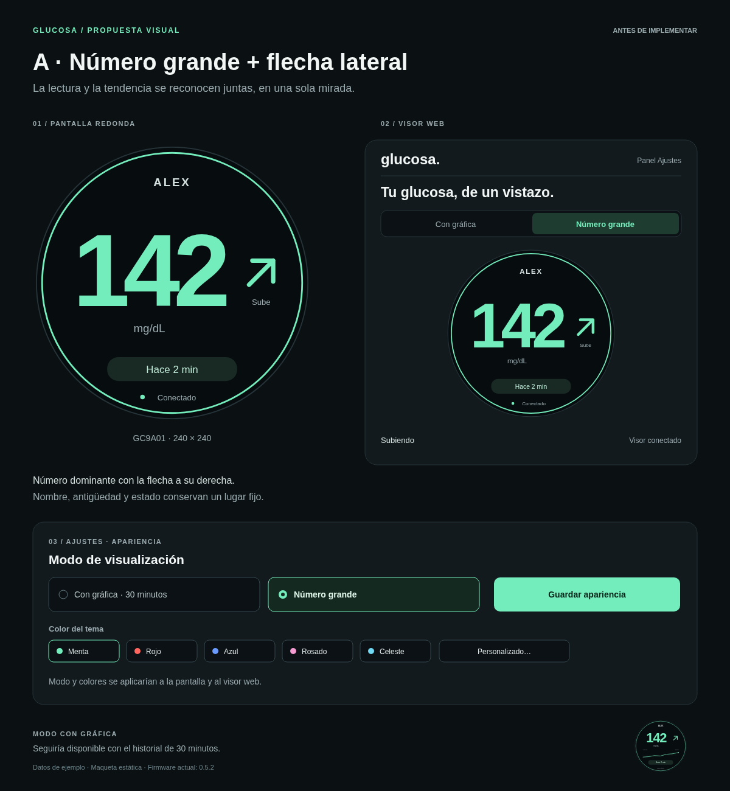
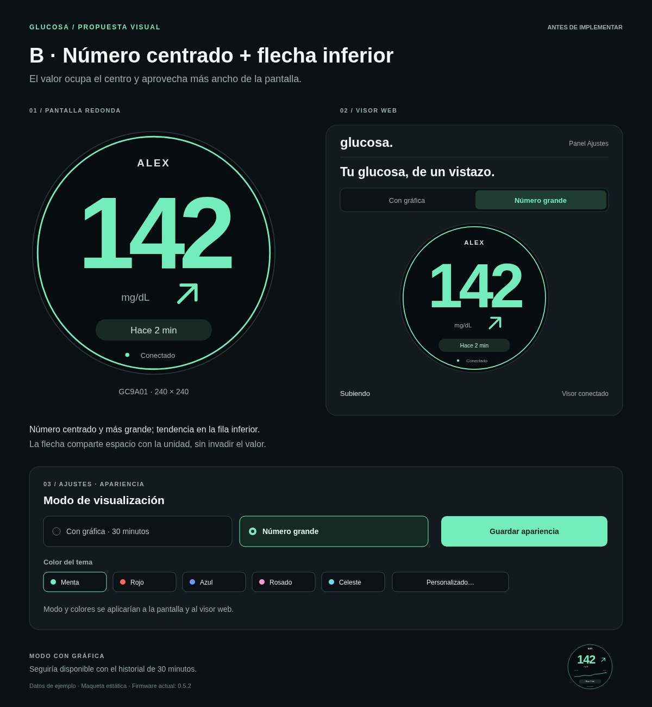
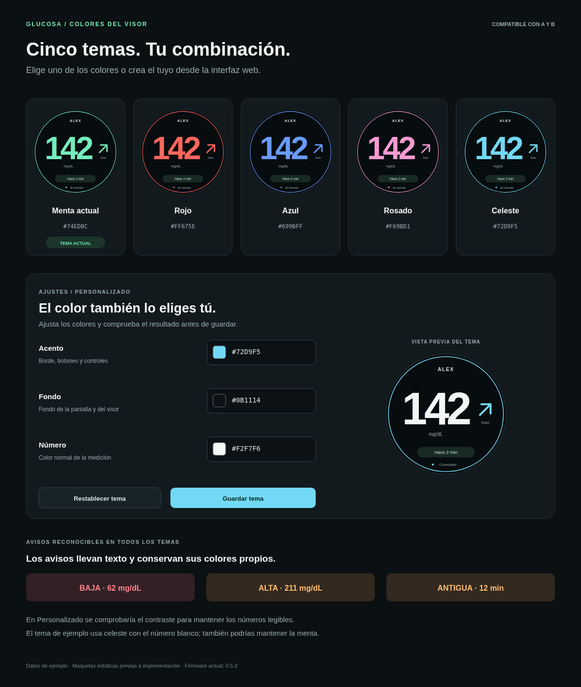

# Propuestas de visor y colores

Maquetas originales previas a implementación. Los diseños A y B están disponibles
en el firmware **0.6.0**, junto con los temas y la personalización de colores. Muestran el modo de número grande,
su copia en la web y el selector para volver a la gráfica de **30 minutos**.
«ALEX» y «142 mg/dL» son datos de ejemplo. Las imágenes son estáticas.

| Propuesta | Composición |
| --- | --- |
| [A · Flecha lateral](propuesta-a.png) | Lectura grande y flecha a la derecha; valor y tendencia se ven juntos. |
| [B · Flecha inferior](propuesta-b.png) | Número centrado, con más ancho; unidad y flecha en la fila inferior. |
| [Temas y personalización](temas-y-personalizacion.png) | Menta actual, rojo, azul, rosado y celeste; opción para personalizar acento, fondo y número. |

La opción propuesta en **Ajustes → Apariencia** guardaría el modo y el tema para
la pantalla física y el visor web. El panel web también tendría un selector de
modo. Las consultas seguirían cada 30 segundos y la gráfica conservaría sus
30 minutos y siete puntos.

Los avisos de lectura baja, alta, antigua y errores conservarían texto visible
y colores propios. La personalización comprobaría el contraste. Las medidas y
la tipografía de las maquetas se ajustarían a las fuentes del GC9A01 durante la
implementación, con dibujo directo y sin guardar imágenes de los temas en RAM.

## A · Número grande y flecha lateral

## B · Número centrado y flecha inferior

## Cinco temas y colores personalizados

Las fuentes editables están junto a las imágenes: [A en SVG](propuesta-a.svg),
[B en SVG](propuesta-b.svg) y [temas en SVG](temas-y-personalizacion.svg).
La implementación incorpora ambos diseños y un nombre de persona más grande
y algo más abajo. Las capturas actuales están en el [README principal](../../README.md#pantallas-y-personalización).
