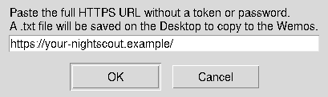
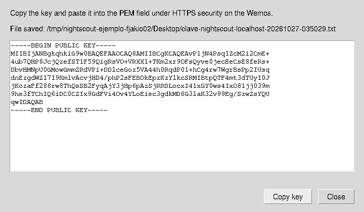

# Get your Nightscout public key

[Español](README.md) · **English**

These tools ask for **one HTTPS URL**, verify the site and save its public key
as a `.txt`. They do not need your token, request glucose readings or change
Wemos settings. Use them only if you choose the optional pinned-key HTTPS mode.

## English downloads

| System | Download | Open |
| --- | --- | --- |
| Windows 10/11 | [Windows ZIP](nightscout-key-windows-en.zip) | Extract and double-click `Get-Nightscout-Key.cmd`. |
| macOS | [Linux/macOS ZIP](nightscout-key-linux-macos-en.zip) | Extract and double-click `Get-Nightscout-Key.command`. |
| Linux | [Shell script](get-nightscout-key.sh) or [ZIP](nightscout-key-linux-macos-en.zip) | Run `bash get-nightscout-key.sh`. |

On GitHub, use **Download raw file** when downloading an individual script.
The ZIPs include instructions. [SHA-256 sums](SHA256SUMS) verify the downloads.
These are system-tool launchers, not compiled executables; Python's `cryptography`
package is not required.

## Windows

Extract the ZIP, double-click the CMD and paste the full URL, such as
`https://your-nightscout.example/`. Select **Get key**. Windows PowerShell and
its normal trusted certificates perform verification; no Python/OpenSSL install
is needed.

A new TXT is saved on the Desktop, or in your user folder if no Desktop exists.
The result window has **Copy key** and **Open .txt** buttons. Previous files are kept.

## Linux and macOS

On macOS, extract/open the `.command`; it uses native dialogs and certificate
verification. You can also run the shell script in Terminal.

On Linux, open a terminal in the downloaded folder:

```bash
bash get-nightscout-key.sh
```

Paste the URL into the window. The file is saved to the configured Desktop or
home-folder fallback and opened for copying. Linux uses Zenity, KDialog or
Python 3 with Tk for dialogs; without a supported graphical environment it asks
in the terminal. OpenSSL is required; macOS includes system tools for this flow.

## Paste it into the Wemos

1. Open **Settings → HTTPS security and option without NTP**.
2. Paste the complete TXT into the PEM field, including `-----BEGIN PUBLIC KEY-----`
   and `-----END PUBLIC KEY-----`.
3. Select **Save server**, leaving the clear-key checkbox unchecked.

The TXT contains only the public key, without private keys, passwords or explanatory
text. Filenames begin `clave-nightscout-` in both language editions and include
the site/date. They are never overwritten.

## If verification fails

Check Internet, URL and computer date/time. The URL must start with `https://`
and contain no username, password, token or query parameters. Expired, not-yet-valid,
untrusted or wrong-host certificates are rejected without exporting a key.
Verification is never bypassed.

A pinned key can survive certificate renewal when the server keeps that key.
If the key changes, repeat the verified export and save it on the Wemos.

## Screenshots and provenance

English Linux input and result windows, captured from the actual Tk interface
with a verified local test key:





The [Spanish documentation](README.md#capturas) also contains real Windows captures.
The Windows English edition uses those same forms with translated labels; macOS
uses native dialogs. Examples are synthetic and do not identify a patient.
The [sample TXT](../../docs/examples/clave-publica-ejemplo.txt) is not a key for
your server. Generate your own from its verified URL.

## Optional terminal use and maintenance

```bash
bash get-nightscout-key.sh --url https://your-nightscout.example/ --output-dir . --headless --no-open
```

`--ca-file trusted-ca.pem` supports an explicitly trusted private CA on Unix.
On macOS, the captured chain is verified against the Keychain SSL policy and
server hostname; the tool does not install a CA. All variants use TLS 1.2, matching
the ESP8266. Windows negotiation follows its Schannel policy.

English files are generated from the same Spanish sources by
`python tools/package_key_tools.py`, using `translations/en.json`. Edit sources
and catalog, not generated English launchers. Both editions share the certificate,
public-key encoding, no-overwrite and no-application-request behavior. CI tests
Windows, Linux and macOS; test-only roots are confined to the ephemeral Windows
runner and removed afterwards. The downloaded tools do not modify trust stores.

[English installation guide](../../docs/INSTALLATION.en.md#8-https-time-and-public-keys)
