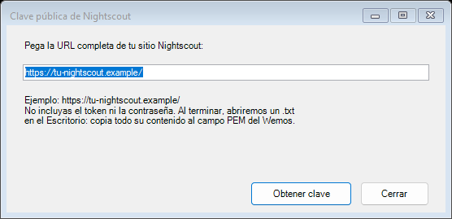
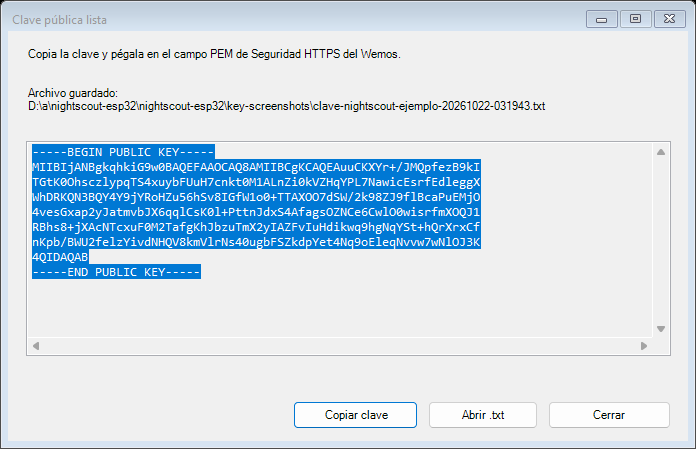
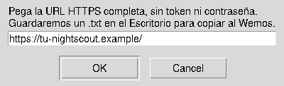
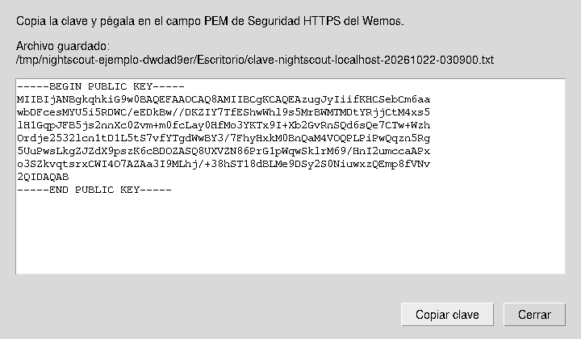

# Obtener la clave pública de tu Nightscout

Estas herramientas piden **una URL**, verifican la identidad del sitio y guardan
un archivo `.txt` con su clave pública. No necesitan el token, no consultan
lecturas y no cambian el firmware ni los ajustes del Wemos.

## Descargas

| Sistema | Archivo recomendado | Cómo abrirlo |
| --- | --- | --- |
| Windows 10/11 | [ZIP para Windows](clave-nightscout-windows.zip) | Extraer y hacer doble clic en el `.cmd` |
| macOS | [ZIP para Linux/macOS](clave-nightscout-linux-macos.zip) | Extraer y hacer doble clic en el `.command` |
| Linux | [Script .sh](obtener-clave-nightscout.sh) o [ZIP](clave-nightscout-linux-macos.zip) | Ejecutar `bash obtener-clave-nightscout.sh` |

Los ZIP contienen las instrucciones y el lanzador listo para abrir. Las
[sumas SHA-256](SHA256SUMS) permiten comprobar las descargas. No son ejecutables
compilados: utilizan herramientas del sistema y no necesitan instalar la
biblioteca Python `cryptography`.

## Windows 10 y 11

Descarga el [ZIP de Windows](clave-nightscout-windows.zip), extráelo y abre
`Obtener-clave-Nightscout.cmd` con doble clic. También está el
[CMD independiente](Obtener-clave-Nightscout.cmd) en **Download raw file** de GitHub.
Pega la dirección completa
(por ejemplo `https://tu-nightscout.example/`) y pulsa **Obtener clave**.
No necesitas instalar Python ni OpenSSL: usa Windows PowerShell y los
certificados de confianza del sistema.

El archivo se guarda en el Escritorio y se abre una ventana con **Copiar clave**.
Si el Escritorio no existe, se utiliza tu carpeta de usuario. También puedes
abrir el `.txt` con el botón **Abrir .txt**. Cada extracción crea un archivo nuevo.

## Linux y macOS

Descarga [obtener-clave-nightscout.sh](obtener-clave-nightscout.sh). En una terminal,
desde la carpeta donde lo guardaste, ejecuta:

```bash
bash obtener-clave-nightscout.sh
```

Pega la URL en la ventana y confirma. El `.txt` se guarda en el Escritorio y
se abre para copiarlo. En Linux se utiliza el Escritorio configurado por XDG;
si no está disponible, se guarda en tu carpeta de usuario.

En macOS también puedes extraer el ZIP y abrir
`Obtener-clave-Nightscout.command` con doble clic. Usa sus ventanas y el llavero
del sistema. Linux usa Zenity, KDialog o,
como alternativa, Python 3 con Tk. Basta con tener una de esas opciones para
mostrar la ventana; si no hay ninguna, pide la URL en la terminal. OpenSSL debe
estar instalado (macOS ya incluye una versión del sistema).

## Capturas

Son ventanas reales de las herramientas, con URL y claves **de ejemplo**.
Windows se capturó en un runner Windows; Linux, usando la alternativa Tk en X11.
El aspecto cambia según el sistema y el escritorio. macOS utiliza su diálogo nativo.
Las claves de estas imágenes y del [TXT de ejemplo](../../docs/examples/clave-publica-ejemplo.txt)
no corresponden a tu servidor: genera la tuya con su URL.

### Windows · Dirección del sitio



### Windows · Clave lista para copiar



### Linux · Dirección del sitio



### Linux · Clave lista para copiar



## Pegarla en el Wemos

1. Abre **Ajustes → Seguridad HTTPS y opción sin NTP**.
2. Pega **todo** el contenido del `.txt` en el campo PEM, incluyendo
   `-----BEGIN PUBLIC KEY-----` y `-----END PUBLIC KEY-----`.
3. Guarda el servidor. No marques la opción de borrar la clave.

El `.txt` contiene solamente la clave pública, sin instrucciones adicionales,
contraseñas ni claves privadas. Se guarda como `clave-nightscout-sitio-fecha.txt`;
los archivos anteriores se conservan.

## Si no puede obtener la clave

Comprueba Internet, la fecha/hora del equipo y que la dirección empiece por
`https://`. Usa la URL del sitio sin usuario, contraseña, token ni parámetros.
Si el certificado está vencido, no es confiable o no corresponde al sitio, la
herramienta se detiene y no exporta una clave. No desactiva esa verificación.
La clave fija seguirá sirviendo mientras el servidor conserve la misma clave,
aunque renueve su certificado; si cambia de clave, repite la extracción.

## Uso por terminal y pruebas

La versión Unix admite, opcionalmente:

```bash
bash obtener-clave-nightscout.sh --url https://tu-nightscout.example/ --output-dir . --headless --no-open
```

`--ca-file archivo.pem` permite indicar una CA privada de confianza para Unix,
como en la herramienta Python original. En macOS se valida la cadena capturada
con la política SSL del llavero y el nombre del sitio antes de exportar la clave.
No se instala esa CA en el sistema.

Las pruebas de TLS local comparan el PEM con la clave esperada para RSA y
P-256/P-384/P-521, rechazan certificados vencidos/no confiables/de otro nombre,
URLs con secretos, certificados todavía no vigentes y puertos inválidos, y comprueban que no se sobreescriban archivos.
Las pruebas de Windows utilizan raíces temporales exclusivamente en su entorno
de pruebas y las retiran al terminar; la herramienta descargable no modifica
el almacén de certificados.

Se utiliza TLS 1.2, como en el ESP8266. En Windows la negociación depende de
Schannel y de la política TLS del sistema. La conversión P-521 se prueba también
por separado, porque Windows no incluye esa curva en su política TLS 1.2 habitual.
Las pruebas que añaden raíces locales se ejecutan en el runner Windows efímero,
con limpieza posterior; el lanzador distribuido nunca añade raíces ni modifica
la política TLS.

Para regenerar los ZIP tras editar los lanzadores: `python tools/package_key_tools.py`.
El `.command` es una copia exacta del `.sh`; los permisos de ejecución se conservan
dentro del ZIP. Las pruebas verifican contenido, permisos y sumas de los paquetes.
